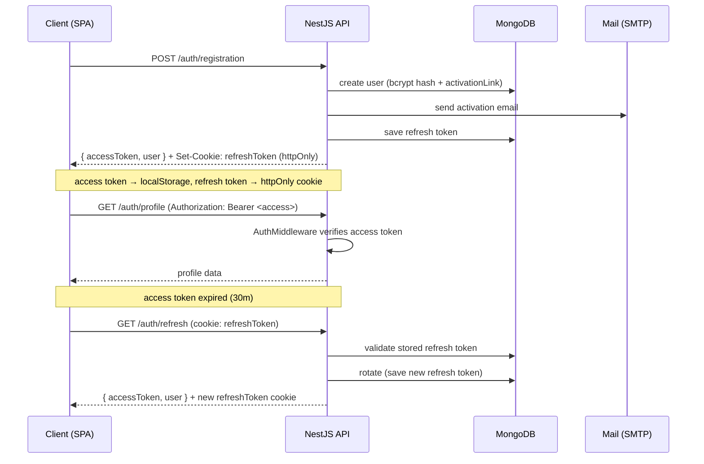

# JWT Auth

A full-stack authentication system built from scratch to demonstrate a complete, production-style **JWT access/refresh token flow** — including email account activation and password reset — without relying on a third-party auth provider.

<p>
  
  
  
  
  
  
</p>

---

## Overview

This project implements the authentication layer most apps need, end to end:

- **Short-lived access tokens** (30 min) sent to the API as a `Bearer` header.
- **Long-lived refresh tokens** (30 days) persisted server-side and delivered as an **`httpOnly` cookie**, so they are never exposed to JavaScript.
- **Token rotation** — every refresh issues a new pair and replaces the stored refresh token.
- **Email-based account activation** and a **secure password-reset flow** via one-time links.

The repository is a monorepo with two independent apps:

| App                     | Responsibility                                            |
| ----------------------- | --------------------------------------------------------- |
| [`server/`](server)     | NestJS REST API, MongoDB persistence, token & mail logic  |
| [`client/`](client)     | React SPA (Vite) consuming the API with React Query + Axios |

## Features

- 🔐 **Register / Login / Logout** with `bcrypt`-hashed passwords
- 🔑 **Access + refresh JWT** issuance, verification and rotation
- 🍪 Refresh token stored in an `httpOnly` cookie and mirrored in MongoDB
- ✉️ **Account activation** by email (one-time UUID link)
- 🔁 **Password reset** request → emailed link → link validation → new password
- 🛡️ **Protected route** (`/profile`) guarded by an auth middleware
- ✅ Request validation with `class-validator` DTOs
- 🎨 Responsive UI with Tailwind CSS + DaisyUI

## Tech stack

**Server** — NestJS 10 · TypeScript · MongoDB + Mongoose 8 · `jsonwebtoken` · `bcrypt` · `class-validator` / `class-transformer` · `nodemailer` · `cookie-parser` · `uuid`

**Client** — React 18 · TypeScript · Vite 5 · React Router 6 · TanStack Query 5 · Axios · Tailwind CSS 3 · DaisyUI

## Architecture

```
┌─────────────────────┐        Bearer access token (header)        ┌──────────────────────┐
│   React SPA (Vite)   │  ───────────────────────────────────────▶ │     NestJS API       │
│                      │                                            │                      │
│  React Query + Axios │ ◀───────── refresh token (httpOnly) ─────▶ │  Auth / Token / Mail │
└─────────────────────┘                                            └──────────┬───────────┘
                                                                               │
                                                                      ┌────────▼────────┐
                                                                      │     MongoDB     │
                                                                      │  users · tokens │
                                                                      └─────────────────┘
```

### Authentication flow



## API reference

Base URL: `http://localhost:5000/auth`

| Method | Endpoint                          | Auth          | Body / Params                 | Description                               |
| ------ | --------------------------------- | ------------- | ----------------------------- | ----------------------------------------- |
| `POST` | `/registration`                   | —             | `email, password, fullName, age` | Create a user, send activation email   |
| `POST` | `/login`                          | —             | `email, password`             | Authenticate and issue tokens             |
| `POST` | `/logout`                         | cookie        | —                             | Invalidate the refresh token              |
| `GET`  | `/activate/:link`                 | —             | `:link`                       | Activate an account                       |
| `GET`  | `/refresh`                        | cookie        | —                             | Rotate tokens using the refresh cookie    |
| `POST` | `/reset-password`                 | —             | `email`                       | Request a password-reset email            |
| `GET`  | `/validate-password-link/:link`   | —             | `:link`                       | Check a reset link is valid               |
| `POST` | `/reset-password/:link`           | —             | `:link`, `password`           | Set a new password                        |
| `GET`  | `/profile`                        | Bearer access | —                             | Return the authenticated user's profile   |

## Getting started

### Prerequisites

- Node.js 18+
- Yarn
- A MongoDB database (local or a free [MongoDB Atlas](https://www.mongodb.com/atlas) cluster)
- An SMTP account for outgoing mail (e.g. a Gmail App Password)

### 1. Server

```bash
cd server
cp .env.example .env     # then fill in the values
yarn
yarn start:dev           # http://localhost:5000
```

### 2. Client

```bash
cd client
yarn
yarn dev                 # http://localhost:5173
```

### Environment variables (`server/.env`)

| Variable             | Description                                              |
| -------------------- | -------------------------------------------------------- |
| `PORT`               | Port the API listens on (e.g. `5000`)                    |
| `DB_URL`             | MongoDB connection string                                |
| `JWT_ACCESS_SECRET`  | Secret for signing access tokens                         |
| `JWT_REFRESH_SECRET` | Secret for signing refresh tokens                        |
| `MAIL_USER`          | SMTP username / sender address                           |
| `MAIL_PASS`          | SMTP password (Gmail App Password recommended)           |
| `CLIENT_URL`         | Base URL of the client, used to build email links        |

> Generate strong secrets with `openssl rand -hex 32`.

## Project structure

```
jwt-auth/
├── server/                       # NestJS API
│   └── src/
│       ├── auth/
│       │   ├── auth.controller.ts    # route handlers
│       │   ├── auth.service.ts       # registration / login / reset logic
│       │   ├── token/                # JWT sign & verify, refresh storage
│       │   ├── mail/                 # nodemailer activation / reset emails
│       │   ├── middlewares/          # access-token guard for /profile
│       │   ├── dto/                  # request validation
│       │   └── schemas/              # Mongoose User & Token models
│       └── main.ts                   # bootstrap, CORS, cookies, validation
│
└── client/                       # React SPA
    └── src/
        ├── pages/                    # Login, Registration, Profile, Reset, Activate
        ├── shared/
        │   ├── api/                  # typed Axios client (AuthApi)
        │   └── ui/                   # shared layout
        └── app/                      # router & app shell
```

## Possible improvements

A few directions this project could be taken further in a production setting:

- Replace the custom `AuthMiddleware` with a NestJS `Guard` + `@nestjs/passport` strategy.
- Store the access token in memory (not `localStorage`) and add an Axios interceptor that transparently refreshes on `401`.
- Add rate limiting (`@nestjs/throttler`) and account-lockout on repeated failed logins.
- Expire reset links (TTL) and invalidate them after a single use.
- Add unit / e2e test coverage and CI.

## License

Released for portfolio and educational purposes.
